# Mineração de Dados Educacionais — Beready

**Comportamento de interação × desempenho de estudantes: análise dos datasets ARES e EdNet seguindo o CRISP-DM**

> **Objetivo do projeto:** descobrir quais características do comportamento dos estudantes estão relacionadas ao desempenho e usar essas descobertas para orientar melhorias no site Beready.

---

## Sumário

1. [Resumo executivo](#1-resumo-executivo)
2. [Metodologia CRISP-DM](#2-metodologia-crisp-dm)
3. [Fase 1 — Entendimento do negócio](#3-fase-1--entendimento-do-negócio)
4. [Fase 2 — Entendimento dos dados](#4-fase-2--entendimento-dos-dados)
5. [Fase 3 — Preparação dos dados (limpeza, sanitização, validação e normalização)](#5-fase-3--preparação-dos-dados)
6. [Fase 4 — Modelagem / mineração](#6-fase-4--modelagem--mineração)
7. [Fase 5 — Avaliação: respostas por dataset](#7-fase-5--avaliação-respostas-por-dataset)
8. [Comparação entre os datasets](#8-comparação-entre-os-datasets)
9. [Fase 6 — Implantação: recomendações para o site](#9-fase-6--implantação-recomendações-para-o-site)
10. [Limitações e validade](#10-limitações-e-validade)
11. [Reprodutibilidade](#11-reprodutibilidade)
12. [Glossário](#12-glossário)
13. [Revisão metodológica (registro de correções)](#13-revisão-metodológica-registro-de-correções)

---

## 1. Resumo executivo

> **Versão revisada (11/10/2026, 2ª auditoria).** As análises de Q1 (EdNet), Q4, Q5 (EdNet) e Q10 foram corrigidas. Cada problema, a correção e o código estão na [§13](#13-revisão-metodológica-registro-de-correções). Todos os números deste documento vêm da execução revisada e são conferidos por um recálculo independente (`src/auditoria.py`: 93/93 verificações conferem).

**Como ler os resultados.** Para cada pergunta separamos quatro coisas que não devem ser confundidas:

1. **Observado:** o que os dados mostram, descritivamente.
2. **Significância estatística:** se o resultado é distinguível do acaso (p < 0,05; corrigido por Holm quando há 10 testes).
3. **Magnitude / relevância prática:** o tamanho do efeito. |ρ| < 0,1 desprezível · 0,1–0,3 fraco · 0,3–0,5 moderado · ≥ 0,5 forte. No EdNet, com dezenas de milhares de estudantes, um ρ de 0,04 dá p < 0,001 e **continua desprezível**. No ARES, “não significativo” **não** prova ausência de efeito: com n = 141, só ρ ≥ 0,24 seria detectado com segurança.
4. **Limitação causal:** todos os resultados são associações observacionais. Nenhum mostra que uma interação *causa* melhor desempenho ou engajamento.

| Pergunta | Base | Observado | Significância | Magnitude / relevância | Conclusão |
|---|---|---|---|---|---|
| **Q1** — Frequência de interação × desempenho | ARES (n = 141) | Spearman ρ = +0,08 (Pearson r = +0,12) entre nº de interações e nota no pós-teste | Não significativo (p = 0,35; Pearson p = 0,17) | Desprezível. O IC95% (−0,09 a +0,24) não descarta efeito fraco | Associação **não detectada** |
| | EdNet (n = 76.252) | ρ = +0,15 entre nº de interações e acurácia fora do diagnóstico; +0,14 controlando o diagnóstico | Significativo (p < 0,001) | **Fraca**. Sessões e dias ativos: desprezíveis (0,07–0,08) | Associação positiva **fraca** |
| **Q4** — Tipos de interação × engajamento | ARES (n = 192) | Leitura de textos +0,31 e navegação +0,24 (índice de persistência, volume controlado) | Só essas duas são significativas após Holm (p < 0,001 e p = 0,007) | Moderada / fraca | Estudar conteúdo está associado a voltar mais vezes |
| | EdNet (n = 111.748) | Aulas +0,24, questões salvas +0,24, caderno de erros +0,17, revisão +0,16. Explicações +0,06 | Todas p < 0,001 (efeito do n) | Todas **fracas** ou desprezíveis | Estudo/revisão associados a voltar mais, com efeito fraco |
| **Q5** — Frequência × evolução | ARES (n = 141) | ρ = 0,00 entre interações e (pós − pré) | Não significativo (p = 0,99) | Desprezível. IC95% −0,16 a +0,17 não descarta efeito fraco | Associação **não detectada** |
| | EdNet (n = 42.720) | ρ = +0,04; evolução média +1,0 p.p. (mediana 0) | Significativo (p < 0,001) só pelo tamanho da amostra | **Desprezível** (sem relevância prática) | Sem associação relevante |
| **Q10** — Atividades: uso × desempenho | ARES (n = 192 uso; 141 desempenho) | Mais usada: responder questões (48% dos eventos). Maiores ρ parciais: vocabulário +0,17, tutorial −0,23 | **Nenhuma** significativa após Holm (tutorial p = 0,054; vocabulário 0,38) | Fraca, incerta | Sem evidência firme de relação |
| | EdNet (n = 297.915 uso; 66.062 desempenho) | Mais usada: prática (72% dos eventos, 89% dos ativos). Prática +0,16 e explicações +0,14 (controle do diagnóstico); com volume: +0,10 e +0,02 | p < 0,001 (efeito do n) | **Fraca** (prática) / desprezível (o resto, controlando o volume) | Só a prática mantém associação fraca além de “usar mais” |

**Mensagem geral:** os dados **não** mostram que interagir mais leve a aprender mais. A associação é fraca no EdNet e não foi detectada no ARES. Nas duas bases, dedicar mais do uso a **conteúdo de estudo** acompanha voltar mais vezes à plataforma, mas isso é associação, não causa. O fato descritivo mais forte para o Beready é o **abandono logo após a atividade de entrada**: 62,5% dos estudantes do EdNet nunca passaram do diagnóstico inicial. As recomendações da [§9](#9-fase-6--implantação-recomendações-para-o-site) são **hipóteses a testar** (teste A/B), não efeitos demonstrados.

---

## 2. Metodologia CRISP-DM

O trabalho segue as seis fases do **CRISP-DM** (*Cross-Industry Standard Process for Data Mining*). Cada fase corresponde a uma seção deste documento e a um script do repositório:

```
 ┌──────────────────────┐   ┌──────────────────────┐   ┌──────────────────────────┐
 │ 1. Entendimento do   │──▶│ 2. Entendimento dos  │──▶│ 3. Preparação dos dados  │
 │    negócio (§3)      │◀──│    dados (§4)        │   │  ares_01_prepare.py      │
 └──────────────────────┘   └──────────────────────┘   │  ednet_01_extract.py     │
            ▲                                          └────────────┬─────────────┘
            │                                                       ▼
 ┌──────────┴───────────┐   ┌──────────────────────┐   ┌──────────────────────────┐
 │ 6. Implantação (§9)  │◀──│ 5. Avaliação (§7–8)  │◀──│ 4. Modelagem (§6)        │
 │  recomendações site  │   │  comparacao.py       │   │  ares_02_analise.py      │
 └──────────────────────┘   └──────────────────────┘   │  ednet_02_analise.py     │
                                                       └──────────────────────────┘
```

Cada dataset foi analisado **separadamente**, com o mesmo método e as mesmas definições sempre que possível. Só depois os resultados foram **comparados** (§8).

### Passo a passo em notebooks (`notebooks/`)

Cada etapa descrita neste documento está **demonstrada e executada** em notebooks Jupyter, na mesma ordem, com código, tabelas e gráficos. No final de cada notebook, os números calculados ali são **conferidos** com os resultados oficiais (`outputs/tables/`). Assim, o notebook, o código de `src/` e este documento mostram os mesmos valores.

| Notebook | Fase CRISP-DM | Seção deste documento |
|---|---|---|
| `01_entendimento_dos_dados.ipynb` | 1–2. Negócio e dados | §3, §4 |
| `02_preparacao_ARES.ipynb` | 3. Preparação (ARES) | §5.1 |
| `03_preparacao_EdNet.ipynb` | 3. Preparação (EdNet) | §5.2, §5.3 |
| `04_Q1_interacao_desempenho.ipynb` | 4–5. Mineração e avaliação | §6, §7.1, §13 (problemas 4 e 6) |
| `05_Q4_engajamento.ipynb` | 4–5 | §7.2, §13 (problema 1) |
| `06_Q5_evolucao.ipynb` | 4–5 | §7.3, §13 (problema 2) |
| `07_Q10_atividades.ipynb` | 4–5 | §7.4, §13 (problema 3) |
| `08_comparacao_e_recomendacoes.ipynb` | 5–6. Avaliação e implantação | §8, §9, §10 |
| `09_auditoria.ipynb` | Verificação final | §13 |

Os notebooks já vêm **executados**, com as saídas salvas, e podem ser lidos sem rodar nada. Para executá-los de novo: abra no VS Code/Jupyter e use **Run All**, ou rode `python run_all.py --notebooks`.

---

## 3. Fase 1 — Entendimento do negócio

### 3.1 Contexto

O Beready é um site de aprendizagem. Para melhorá-lo, queremos entender com dados reais de outras plataformas educacionais **quais comportamentos dos estudantes estão ligados a engajamento e desempenho**.

### 3.2 Perguntas de mineração escolhidas

Das 10 perguntas propostas, quatro foram escolhidas por terem **alta viabilidade** com os dados disponíveis:

| # | Pergunta | Por que é viável |
|---|---|---|
| **Q1** | Existe relação entre a frequência de interação do estudante com a plataforma e seu desempenho de aprendizagem? | ARES tem interações e pré/pós-teste. EdNet tem interações e respostas corrigíveis. |
| **Q4** | Quais tipos de interação ou atividades estão associados a maior engajamento dos estudantes? | ARES tem diversos verbos/objetos xAPI. EdNet tem tipos de ação e origens de atividade. |
| **Q5** | Existe relação entre a frequência de acesso/interação e a evolução do desempenho dos estudantes? | ARES tem pré e pós-teste. No EdNet, a evolução pode ser medida ao longo da sequência de respostas. |
| **Q10** | Quais tipos de atividades apresentam maior frequência de utilização e maior relação com o desempenho? | As duas bases registram o tipo de atividade de cada evento e têm uma medida de desempenho. |

### 3.3 Datasets avaliados

| Dataset | Tamanho | Uso | Motivo |
|---|---|---|---|
| **ARES / Triangulating Multimodal Data** (OSF `8y3zp`) | 18,3 MB | ✅ Principal | Tem interações e pré/pós-teste dos mesmos alunos |
| **EdNet** (Riiid — KT3 + Contents) | 763 MB zip (3,5 GB descompactado) + 580 KB | ✅ Principal para comportamento | 89 milhões de interações com tempo, origem, plataforma e respostas |
| Speak & Improve Corpus 2025 | — | ❌ Não usado | Focado em fala/proficiência CEFR, sem log de interação |
| English Classroom Interaction Behavior (Kaggle) | 236 MB | ❌ Não usado | Não responde às 4 perguntas escolhidas (serve à Q8) |

### 3.4 Critério de sucesso

- Responder cada pergunta **para cada dataset separadamente**, com estatística apropriada e gráficos.
- Comparar as respostas e identificar o que é **convergente** (vale para as duas plataformas, portanto mais generalizável para o Beready) e o que é **específico** de cada uma.
- Transformar os achados em recomendações práticas para o site.

---

## 4. Fase 2 — Entendimento dos dados

### 4.1 ARES

Plataforma de leitura em inglês (Mintly/kibi.group). Alunos leem textos, respondem tarefas, consultam explicações de palavras e veem a avaliação do professor. Período dos eventos de alunos: **10/11/2024 a 05/02/2025**.

#### Arquivos e volume (dados brutos)

| Arquivo | Linhas | Colunas | Nulos | Duplicadas | Conteúdo |
|---|---:|---|---|---:|---|
| `raw/xapi_statement_student.xlsx` | 124.954 | id, statement_id, registration, verb_iri, is_voided, payload, timestamp, stored | `registration`: 124.954 (100% vazia) | 0 | Log xAPI bruto (JSON no `payload`) |
| `preprocessed/xapi_statement_student.xlsx` | **116.168** | verb, object, timestamp, actor, context | 0 | **2.184** | Log xAPI já extraído pelos autores (**usado**) |
| `raw/pre_test_response.xlsx` | 2.520 | id, user_id, prompt, response, timestamp, correct | `response`: 184 | 0 | Respostas do pré-teste (12 questões × 210 alunos) |
| `raw/pre_test_score.xlsx` | 210 | user_id, score | 0 | 0 | Nota do pré-teste |
| `raw/post_test_response.xlsx` | 1.980 | id, user_id, prompt, response, timestamp, correct | `user_id`: 12, `response`: 82 | 0 | Respostas do pós-teste (12 × 165) |
| `raw/post_test_score.xlsx` | 164 | user_id, score | 0 | 0 | Nota do pós-teste |
| `raw/pre_motivation_score.xlsx` | 177 | user_id + 6 escalas MSLQ | 0 | 0 | Motivação (contexto) |
| `raw/response_student.xlsx` | 32.092 | id, user_id, prompt, response, timestamp | `user_id`: 118, `response`: 649 | 0 | Todas as respostas (não necessário) |

> **Achado na validação:** na pasta `preprocessed/`, os arquivos `pre_test_score.xlsx` e `post_test_score.xlsx` **não contêm notas**. São cópias das planilhas de *respostas*: 2.520 e 1.980 linhas em vez de 210 e 164. As notas por aluno só existem em `raw/`, e por isso foram lidas de lá.

#### Dicionário — log de interação (`xapi_statement_student`)

| Campo | Significado | Exemplo |
|---|---|---|
| `actor` | Identificador do usuário (alunos: código de 4 caracteres) | `owxO` |
| `verb` | Tipo de ação (15 verbos) | pressed, entered, opened, focused, exited, submitted, logged-in, enrolled… |
| `object` | Elemento da interface | btn, page, dialog, txtView, token, assignment, evaluation, word-explanation… |
| `timestamp` | Data/hora UTC do evento | `2024-11-15 21:20:18.999+00` |
| `context` | JSON com página (`fragment`), descrição do botão/diálogo, id da tarefa etc. | `{"fragment": "text.html", "btnDescription": "Button to submit an assignment"}` |

Os 15 verbos da base completa (116.168 eventos, antes da limpeza) são: pressed 50.087 · entered 19.672 · opened 15.170 · focused 15.163 · exited 8.180 · submitted 4.877 · logged-in 2.523 · enrolled 242 · updated 113 · created 39 · unenrolled 32 · copied 30 · added 26 · deleted 13 · removed 1.

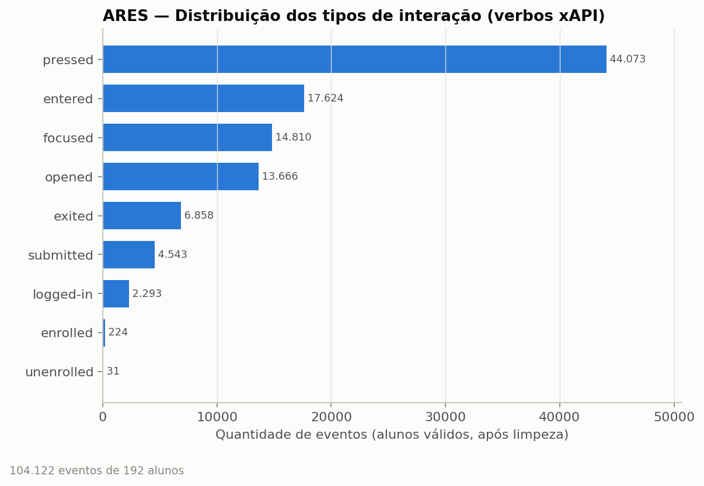

#### Instrumento de desempenho

O pré-teste e o pós-teste têm **12 itens** (Q1–Q8, Q9, Q10-1, Q10-2, Q10-3). A **nota oficial vai de 0 a 11**. A validação (§5.1.3) mostrou que a nota oficial = **acertos em todas as questões exceto a Q9**.

### 4.2 EdNet (KT3 + Contents)

Dados do app **Santa** (Riiid, Coreia do Sul), de preparação para o TOEIC. O **KT3** registra cada ação do estudante: entrar/sair de um conteúdo, responder, submeter. Período: **27/08/2018 a 27/11/2019**.

#### Arquivos e volume

| Arquivo | Linhas | Conteúdo |
|---|---:|---|
| `EdNet-KT3.zip` → `KT3/u*.csv` | **297.915 arquivos** (1 por estudante), **89.270.654 linhas** | Log de ações |
| `contents/questions.csv` | 13.169 | Questões: `question_id`, `bundle_id`, `explanation_id`, **`correct_answer`**, `part`, `tags` |
| `contents/lectures.csv` | 1.021 | Aulas |
| `contents/payments.csv`, `coupons.csv` | 190 / 91 | Não usados (não pertencem ao KT3) |

> O número **297.915** citado no material do grupo é o número de **estudantes** (arquivos) do KT3. Este trabalho processou **todos** eles, não uma amostra.

#### Dicionário — KT3

| Campo | Significado | Valores |
|---|---|---|
| `timestamp` | Momento da ação (ms desde 1970, UTC) | 1552470344907 |
| `action_type` | Ação | `enter`, `respond`, `submit`, `quit` |
| `item_id` | Item acessado. O prefixo indica o tipo | `b`=bloco de questões, `q`=questão, `e`=explicação, `l`=aula |
| `source` | Origem/contexto da atividade | `sprint`, `diagnosis`, `adaptive_offer`, `review_quiz`, `my_note`, `archive`, `tutor`, `review` |
| `user_answer` | Alternativa escolhida (só em `respond`) | a, b, c, d |
| `platform` | Dispositivo | `mobile`, `web` |

---

## 5. Fase 3 — Preparação dos dados

Todo passo está implementado em código e registrado em `outputs/tables/ares_qualidade.json` e `outputs/tables/ednet_qualidade.json`.

### 5.1 ARES — passo a passo (`src/ares_01_prepare.py`)

#### 5.1.1 Limpeza do log de interação

| # | Passo | Linhas removidas | Linhas restantes | Justificativa |
|---|---|---:|---:|---|
| 0 | Leitura de `preprocessed/xapi_statement_student.xlsx` | — | 116.168 | Mesma base usada no gráfico original do grupo |
| 1 | **Remover duplicadas exatas** | **2.184** | 113.984 | Mesmo ator, verbo, objeto, contexto e timestamp até o milissegundo. São disparos duplos do front-end (ex.: “confirm empty answer submission” registrado 2×) |
| 2 | Remover nulos em `actor`/`verb`/`timestamp` | 0 | 113.984 | Validação de campos obrigatórios (nenhum nulo encontrado) |
| 3 | Converter `timestamp` para data UTC e remover datas inválidas ou fora do período do estudo (set/2024–mar/2025) | 0 | 113.984 | Validação de domínio temporal |
| 4 | Converter `context` de JSON e remover JSON inválido | 0 | 113.984 | Sanitização. Extrai página, botão, diálogo e tarefa |
| 5 | **Remover atores que não são alunos válidos** | **9.862** | 104.122 | 19 atores: `Teacher Ares` (4.384), `Test Ares` (1.200), `Admin Kibi` (344), contas de teste (`Mihwa`, `Mihwa2`, `Mihwa3`, `Xiaobin Test1`, `BjoernAisla`, `chxiaobin`, `Li Yuhang`, `Yi`) e alunos excluídos pelos autores (abaixo) |
| 6 | Remover eventos em páginas `teacher_*`/`admin_*` | 0 | 104.122 | Garante que só restam ações de aluno |

O log bruto (`raw/`) tem 124.954 statements, e nenhum deles está anulado (`is_voided = f` em 100%). O arquivo pré-processado pelos autores já tinha 8.786 linhas a menos.

**Lista oficial de exclusão.** Ela vem do notebook dos próprios autores (`script/02_data_user_removal.ipynb`) e foi aplicada às notas e ao log:

| Motivo | IDs |
|---|---|
| Conta de teste | EKEi |
| Professores | 82PN, 0jWs, W2Fl, FUs4, VNzA, P5ze, OVhL |
| Contas não usadas | ZznH, eVKy, zRSE, ImNX, kxxe, am1M, x5ot, Fl9u, 9FEW, wU4m, JmnJ, ow1W, Yp1o, 48jO |
| Sem nenhuma submissão | eKlW, WUkv, zkmh, m25O, F1aL, wgEB, 5AAK, XfM3, R49T, NBrF, zZSe, ggi5, wAr0, wRnG, keoO |
| Sem consentimento | gxjp, K4b1, ntzG, aNxJ, lOkr, QUU6, ewww, QWJu, nC8b, YD86, s3v8, g1gg |

#### 5.1.2 Separação por contexto

Cada evento recebeu um **contexto** de acordo com a página:

| Contexto | Páginas | Eventos | Uso |
|---|---|---:|---|
| **Aprendizagem** | text, student_home, student_assignments, student_classes, login, user_profile… | 92.715 | ✅ Métricas de interação |
| Avaliação | pre_test, post_test | 6.421 | ❌ Excluído das métricas, para não contar a própria prova como “interação” |
| Questionário | background, mslq, motivation, perception, engagement, consent | 4.986 | ❌ Excluído |

Dentro do contexto de aprendizagem, **5.330 eventos gerados pelo sistema** também foram excluídos: diálogos de erro de servidor/rede, “submission conflict” e “test already taken”. Eles não são ações do aluno.

#### 5.1.3 Notas: sanitização e validação cruzada

| Verificação | Pré-teste | Pós-teste | Ação |
|---|---|---|---|
| Linhas de resposta sem `user_id` | 0 | **12** | Removidas |
| Respostas em branco (`response` nulo) | 184 | 82 | Mantidas como **erro** (`correct = f`): o aluno viu a questão e não respondeu |
| Valores fora de {t, f} em `correct` | 0 | 0 | — |
| `user_id` duplicado na planilha de notas | 0 | 0 | — |
| Notas fora de 0–11 | 0 | 0 | — |
| Questões por aluno | 12 em 100% | 12 em 100% | Instrumento completo |
| **Nota recalculada = nota oficial?** | Somando as 12: bate em **71%** dos alunos. **Excluindo a Q9: 100%** | Excluindo a Q9: **100%** | Regra descoberta e validada: **a Q9 não entra na nota** |
| Alunos removidos pela lista dos autores | 25 | 16 | — |
| **Alunos válidos** | **185** | **148** | — |

#### 5.1.4 Integração e atributos derivados (1 linha por aluno)

As notas e o log foram unidos por `user_id` = `actor`. Para cada aluno, considerando **apenas eventos de aprendizagem**:

| Atributo | Definição |
|---|---|
| `n_interacoes` | Nº de eventos de aprendizagem |
| `n_sessoes` | Nº de sessões. **Uma nova sessão começa após mais de 30 min sem eventos** (padrão em análise de logs web) |
| `dias_ativos` | Nº de dias distintos com atividade |
| `tempo_estudo_min` | Soma dos intervalos entre eventos dentro da mesma sessão |
| `n_logins` | Nº de acessos (`logged-in`) |
| `ativ::<categoria>` | Nº de eventos em cada uma das 11 categorias de atividade (abaixo) |
| `nota_pre`, `nota_pos` | Notas oficiais 0–11 |
| `evolucao` | `nota_pos − nota_pre` |
| `ganho_normalizado` | Ganho de Hake = `(pós − pré) / (11 − pré)`: fração da melhora possível que foi alcançada |

**Categorias de atividade.** São regras sobre verbo, objeto, botão e diálogo, criadas para dar significado pedagógico ao clique:

| Categoria | Exemplos de eventos |
|---|---|
| Responder questões/tarefas | focar o campo de resposta, “show questions”, “submit/finish assignment”, `submitted` |
| Leitura de textos | entrar em `text.html`, “redirect to text reading page”, “exit a text” |
| Vocabulário (palavras e traduções) | `pressed token`, `word-explanation`, “translate to Chinese”, seções de pronúncia/colocações |
| Visualização de feedback/nota | `opened evaluation`, “see evaluation”, “see own/class totalScore”, “see correct answer” |
| Avaliação do texto (estrelas) | “star ratings” (dificuldade/interesse do texto) |
| Navegação entre páginas | `entered page` (fora do texto), botões “redirect…”, filtros |
| Turmas (entrar/sair) | `enrolled`/`unenrolled klass`, “confirm join class” |
| Tutorial | “watch a tutorial”, “completed a tutorial”, modal do tutorial |
| Acesso (login) | `logged-in` |
| Outros (diálogos/botões) | fechar mensagens, confirmar diálogos genéricos |
| Alertas/erros do sistema | erros de servidor/rede (**excluídos** das métricas) |

#### 5.1.5 Outliers

Pelo critério IQR (acima de Q3 + 1,5·IQR), 4 alunos têm número de interações atípico (máximo de 1.596). Eles **não foram removidos**: são comportamentos reais, e todas as análises usam **estatística baseada em postos** (Spearman, Kruskal-Wallis), que é robusta a outliers.

#### 5.1.6 Base final ARES

| Conjunto | Alunos | Usado em |
|---|---:|---|
| Alunos válidos (com pré ou pós) | 192 | — |
| Com log de interação | **192** | Q4, Q10 (frequência de uso) |
| Com **pré + pós + log** | **141** | Q1, Q5, Q10 (relação com desempenho) |

Estatísticas dos 192 alunos: mediana de **424 interações**, **11 sessões**, **9 dias ativos** e **154 min** de estudo registrado.

### 5.2 EdNet — passo a passo (`src/ednet_01_extract.py`)

Os 297.915 CSVs foram lidos **diretamente do zip**, sem descompactar os 3,5 GB, em paralelo (14 processos, cerca de 9 min). Em cada arquivo:

| # | Passo | Resultado na base inteira |
|---|---|---|
| 0 | Leitura | **89.270.654 linhas** brutas de 297.915 estudantes |
| 1 | Contagem de nulos por coluna | `timestamp`, `action_type`, `item_id`, `source`, `platform`: **0 nulos**. `user_answer`: 65.886.174 nulos, **esperados**: só ações `respond` têm resposta |
| 2 | **Remover duplicadas exatas** | **75.778 linhas** removidas |
| 3 | Validar `timestamp` (numérico, entre 2017 e 2020) | 0 inválidos |
| 4 | Validar `action_type` ∈ {enter, respond, submit, quit} | 0 inválidos |
| 5 | Validar `item_id` (padrão `[q,b,e,l]` + número) | 0 inválidos |
| 6 | Validar `platform` ∈ {mobile, web} | 0 inválidos |
| 7 | Validar resposta: `respond` deve ter `user_answer` ∈ {a,b,c,d} e ser sobre uma questão `q…` | 0 inválidos |
| 8 | Ordenar por tempo e verificar a ordem | 0 arquivos fora de ordem |
| 9 | **Base limpa** | **89.194.876 linhas** |
| 10 | **Respostas finais.** O estudante pode trocar de alternativa antes de submeter; vale a **última resposta de cada questão antes do `submit`** | **5.325.940** respostas intermediárias descartadas. **17.981.865 respostas finais** |
| 11 | **Correção.** Junção com `questions.csv` (`correct_answer`) | 0 questões sem gabarito. Acurácia geral = **64,84%** |

#### Atributos derivados (1 linha por estudante — `ednet_users.csv.gz`)

| Atributo | Definição |
|---|---|
| `n_eventos`, `n_sessoes` (gap de 30 min), `dias_ativos`, `tempo_estudo_min` | Iguais aos do ARES, para permitir a comparação |
| `acao_*` | Contagem por tipo de ação |
| `src_*` | Eventos por origem da atividade |
| `acessos_explicacao`, `acessos_aula` | Nº de vezes que abriu explicações (`e…`) e aulas (`l…`) |
| `tempo_explicacao_min`, `tempo_aula_min` | Duração dos pares enter→quit. Sessões acima de 60 min são descartadas (aba esquecida aberta) |
| `n_respondidas`, `n_acertos`, `acuracia` | Desempenho geral |
| `resp_*`, `acerto_*` | Desempenho por origem |
| `acuracia_diag` | Acurácia no **diagnóstico inicial** (estudantes com ≥ 5 questões no diagnóstico). Funciona como **“pré-teste”** |
| `acuracia_pos_diag` | Acurácia em todas as questões **depois** do diagnóstico (≥ 10 questões). Funciona como **“pós-teste”** |
| `acuracia_inicio_sem_diag` / `acuracia_fim_sem_diag` | Acurácia nas **primeiras 20** e nas **últimas 20** questões **fora do diagnóstico** (estudantes com ≥ 40 nessas condições). **Usada na Q5** |
| `acuracia_inicio` / `acuracia_fim` | Versão original: primeiras/últimas 20 de qualquer origem. **Mantida só para comparação**, porque mistura o diagnóstico com a prática (§13, problema 2) |
| `evolucao` | `acuracia_fim_sem_diag − acuracia_inicio_sem_diag` |

#### Bases de análise EdNet

| Conjunto | Estudantes | Usado em |
|---|---:|---|
| Todos | 297.915 | Q10 (frequência de uso), descritiva |
| Usaram a plataforma **além do diagnóstico** | **111.748** | Q4 |
| ≥ 10 questões respondidas **fora do diagnóstico** | **76.252** | Q1 |
| Diagnóstico (≥ 5) **e** ≥ 10 questões depois | **66.062** | Q1 e Q10 (controle da proficiência inicial) |
| ≥ 40 questões respondidas **fora do diagnóstico** | **42.720** | Q5 |

**Achado da exploração:** **62,5%** dos estudantes (186.167) **só fizeram o diagnóstico inicial** e nunca voltaram, e 73,3% tiveram uma única sessão. Por isso o Q4 foi feito com quem efetivamente usou a plataforma (§7.2).

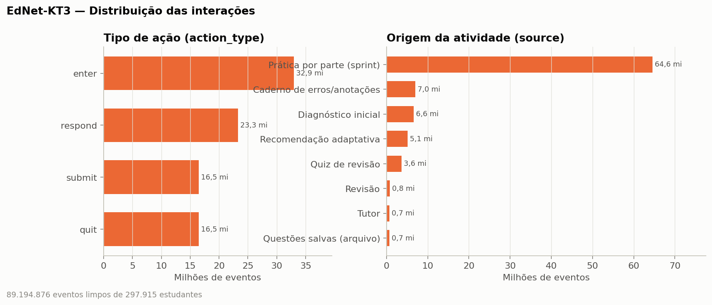

### 5.3 Normalização e transformação

| Técnica | Onde | Por quê |
|---|---|---|
| **Proporção (participação %)** | Q4: `eventos da atividade / total do aluno` | Compara perfis de uso entre alunos com volumes muito diferentes |
| **Ranqueamento percentil (0–100)** | Índice de engajamento (Q4) = média dos percentis de **sessões e dias ativos** (persistência). A primeira versão também incluía interações e tempo, mas isso gerava associação mecânica (§13, problema 1) | Põe métricas em escalas diferentes na mesma escala, sem ser afetado por outliers |
| **Acurácia (0–1)** e **ganho normalizado** | Desempenho | Normaliza pelo nº de questões e pela margem possível de melhora. O ganho normalizado é só complementar: não tem limite inferior (vai até −7) e fica indefinido quando o pré = 11 |
| **Escala logarítmica** | Eixos de nº de interações | As distribuições são muito assimétricas (EdNet: mediana 27, máximo 169.794) |
| **Postos (Spearman)** | Todas as correlações | Não supõe normalidade nem relação linear |
| Unificação de fuso (UTC) e de tipos | Timestamps, IDs | Sanitização |
| *Z-score* — **não usado** | — | Com caudas tão longas, a média e o desvio seriam dominados por poucos usuários extremos |

---

## 6. Fase 4 — Modelagem / mineração

Como as perguntas são de **associação** (“existe relação…”, “quais estão associados…”), as técnicas de mineração são **análise de correlação e comparação de grupos**:

| Técnica | Para quê |
|---|---|
| **Correlação de Spearman (ρ)** com **IC 95% por bootstrap** (1.000 reamostragens; nas bases grandes, 200 × 20 mil) | Força e direção da relação monotônica |
| **Correlação parcial de Spearman** | Relação entre interação e desempenho **removendo o efeito da proficiência inicial** (pré-teste no ARES, diagnóstico no EdNet). Evita confundir “quem já sabia mais” com “quem interagiu mais”. Na Q4 e na Q10 também se controla o **volume total** (log do nº de interações), para separar o efeito de *uma atividade* do efeito de *usar mais a plataforma* |
| **Correção para múltiplos testes (Holm; Benjamini-Hochberg como referência)** | Q4 e Q10 testam 10 atividades por base. Sem correção, a chance de achar pelo menos um “p < 0,05” só por acaso passa de 40% |
| **Pearson (r)** — só como análise de sensibilidade | Reproduz o notebook antigo (Q1). Não é a medida principal porque o nº de interações é muito assimétrico (assimetria = 1,9) e tem outliers |
| **Segmentação em quartis** (de interação ou de engajamento) | Compara grupos de estudantes, do menos ao mais ativo |
| **Kruskal-Wallis** | Diferença entre os 4 quartis |
| **Mann-Whitney + δ de Cliff** | Diferença entre o quartil mais alto e o mais baixo, com tamanho de efeito |
| **Wilcoxon pareado** | Diferença pré × pós (ARES) |

**Leitura do ρ:** |ρ| < 0,1 desprezível · 0,1–0,3 fraca · 0,3–0,5 moderada · ≥ 0,5 forte.

**Atenção à significância:** no EdNet, com dezenas de milhares de estudantes, **quase tudo dá p < 0,001**. Por isso a interpretação se baseia na **magnitude do ρ** e do δ, não no p-valor. No ARES (n = 141), o poder estatístico só detecta correlações a partir de |ρ| ≈ 0,24.

**Adequação dos testes (verificada na 2ª auditoria):**
- **Spearman** em vez de Pearson: o nº de interações é muito assimétrico (assimetria 1,9 no ARES; Shapiro p < 0,001) e as notas são discretas (0–11), com muitos empates. O Spearman usa postos médios para os empates. Pearson foi mantido só como sensibilidade na Q1.
- **Correlação parcial de Spearman:** os postos de x e y são regredidos nos postos dos controles, e os resíduos são correlacionados. O p-valor usa **n − 2 − k graus de liberdade** (k = nº de controles); a versão anterior usava n − 2, com diferença só na 3ª casa decimal.
- **Bootstrap percentil** para os IC95% (sem supor distribuição). Nas bases grandes, foram 200 reamostragens de 20 mil estudantes cada.
- **Wilcoxon pareado** para pré × pós: notas discretas, sem normalidade. As diferenças zero (14% dos alunos) são descartadas pelo procedimento padrão.
- **Kruskal-Wallis / Mann-Whitney / δ de Cliff** para os quartis: não supõem normalidade. O δ de Cliff dá o tamanho do efeito.
- **Holm** para os 10 testes por base em Q4 e Q10. Ele controla a chance de *pelo menos um* falso positivo. Benjamini-Hochberg também é salvo nas tabelas, como referência.

---

## 7. Fase 5 — Avaliação: respostas por dataset

### 7.1 Q1 — Frequência de interação × desempenho

#### ARES (n = 141; desempenho = nota no pós-teste)

| Métrica de frequência | ρ (Spearman) | IC 95% | p | ρ parcial (controle do pré-teste) |
|---|---:|---|---:|---:|
| Nº de interações | +0,08 | [−0,09; +0,24] | 0,35 | +0,06 |
| Nº de sessões | +0,08 | [−0,09; +0,25] | 0,34 | +0,05 |
| Dias ativos | +0,04 | [−0,15; +0,21] | 0,66 | +0,01 |
| Nº de logins | −0,06 | [−0,22; +0,11] | 0,49 | 0,00 |

Nota média por quartil de interação: 5,9 · 4,1 · 5,7 · 6,1. O Kruskal-Wallis dá p = 0,029, mas a diferença vem de uma queda no 2º quartil e **não forma tendência**: 1º × 4º quartil, p = 0,66, δ = 0,06.

**Sensibilidade: Pearson × Spearman.** O notebook antigo do grupo calculou **Pearson r = 0,118**. Com os mesmos 141 alunos e os dados limpos desta documentação, **Pearson r = 0,115** (p = 0,17; IC95% −0,05 a +0,27). A diferença em relação ao ρ = 0,08 é **de método, não de dados**. Detalhes na §13, problema 4. Os dois coeficientes levam à mesma conclusão.

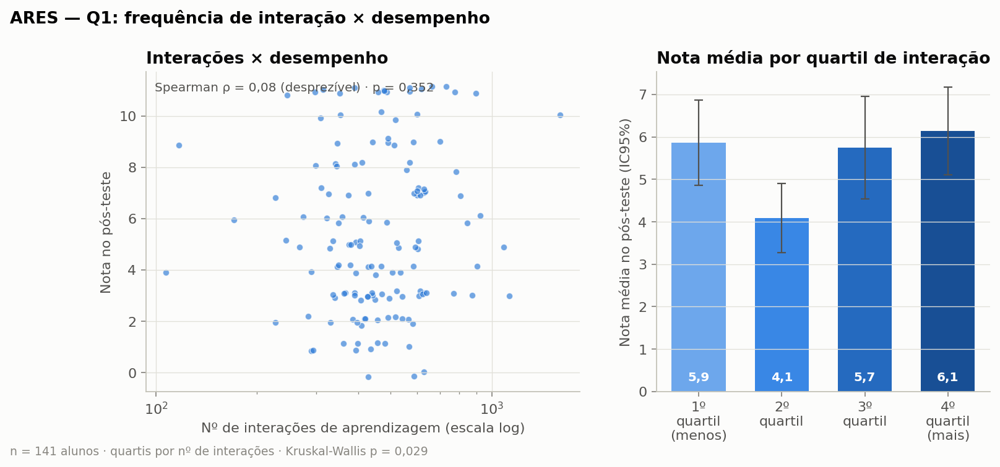

**Resposta (ARES): não foi detectada associação.** Todos os coeficientes são desprezíveis e não significativos, antes e depois de controlar o pré-teste, tanto com Spearman quanto com Pearson. Com 141 alunos, só seria possível detectar correlações a partir de |ρ| ≈ 0,24. Uma associação fraca, como a vista no EdNet, não pode ser descartada.

#### EdNet (n = 76.252; desempenho = acurácia nas questões fora do diagnóstico)

| Métrica de frequência | ρ | IC 95% | p | ρ parcial (controle do diagnóstico, n = 66.062) |
|---|---:|---|---:|---:|
| Nº de interações | **+0,15** | [+0,14; +0,16] | < 0,001 | **+0,14** |
| Nº de sessões | +0,08 | [+0,07; +0,10] | < 0,001 | +0,08 |
| Dias ativos | +0,07 | [+0,06; +0,08] | < 0,001 | +0,07 |

Acurácia média por quartil de interação: **60,3% → 62,4% → 64,2% → 66,4%** (δ de Cliff 4º × 1º = 0,21, efeito pequeno).

> **Correção (2ª auditoria):** a versão anterior usava a acurácia em *todas* as questões e reportava ρ = 0,36, com quartis de 51,5% a 65,1%. Essa acurácia mistura o diagnóstico (mais difícil) com a prática, e a proporção de diagnóstico depende do próprio volume de uso. Entre os menos ativos, a mediana é de 100% das respostas no diagnóstico; entre os mais ativos, 3% (ρ entre interações e % de diagnóstico = −0,93). Detalhes na §13, problema 6.

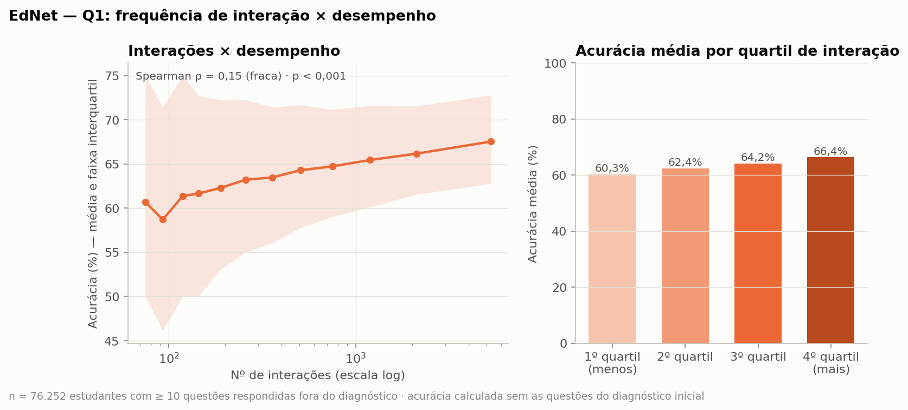

**Resposta (EdNet): associação positiva fraca (ρ = 0,15),** estatisticamente significativa por causa do tamanho da base. Ela se mantém quase igual ao controlar o diagnóstico (0,14). Sessões e dias ativos têm associação desprezível. Na prática, os estudantes mais ativos acertam cerca de 6 p.p. a mais que os menos ativos. Isso não mostra que interagir mais *melhora* a acurácia: estudantes mais motivados ou com mais tempo podem tanto usar mais quanto acertar mais.

### 7.2 Q4 — Tipos de interação associados a maior engajamento

**Como foi medido (versão revisada).**
- **Engajamento** = índice 0–100, média dos percentis de **nº de sessões** e **dias ativos**, ou seja, o quanto o aluno *volta* à plataforma.
- Para cada atividade, calculou-se a correlação parcial entre **a participação dela no uso do aluno** (% das interações) e esse índice, **controlando o volume total de interações** (log).
- Pergunta respondida: *com o mesmo volume de uso, quem dedica uma parte maior a esta atividade volta mais vezes?*
- Os p-valores foram corrigidos para 10 testes (Holm).

**Por que mudou.** A primeira versão incluía o nº de interações e o tempo dentro do próprio índice. Isso cria **associações mecânicas**. A participação de uma atividade com contagem quase fixa (o tutorial, cerca de 3 eventos, ou o diagnóstico, cerca de 25) é aproximadamente “k ÷ total” e cai sozinha quando o total sobe, sem nenhuma relação real com o comportamento. Na outra direção, a explicação do EdNet acompanha cada questão respondida (ρ com o volume total = 0,99) e sobe junto com o índice. A coluna “bruto” mostra os valores antigos só para comparação. Detalhes na §13, problema 1.

#### ARES (n = 192)

| Atividade | ρ corrigido | p (Holm) | ρ bruto (versão anterior) | % que usa: engajamento alto × baixo |
|---|---:|---:|---:|---|
| **Leitura de textos** | **+0,31** | **< 0,001** | +0,09 | 100% × 100% |
| **Navegação entre páginas** | **+0,24** | **0,007** | −0,09 | 100% × 100% |
| Acesso (login) | +0,15 | 0,35 (ns) | −0,09 | 100% × 100% |
| Visualização de feedback/nota | +0,14 | 0,37 (ns) | +0,31 | **33,3% × 8,3%** |
| Outros (diálogos/botões) | 0,00 | 1,00 (ns) | −0,11 | 97,9% × 93,8% |
| Responder questões/tarefas | −0,02 | 1,00 (ns) | 0,00 | 100% × 100% |
| Tutorial | −0,03 | 1,00 (ns) | **−0,56** | 100% × 100% |
| Avaliação do texto (estrelas) | −0,07 | 1,00 (ns) | −0,22 | 100% × 100% |
| Vocabulário (palavras e traduções) | −0,09 | 1,00 (ns) | +0,16 | 100% × 91,7% |
| Turmas (entrar/sair) | −0,12 | 0,54 (ns) | −0,44 | 100% × 100% |

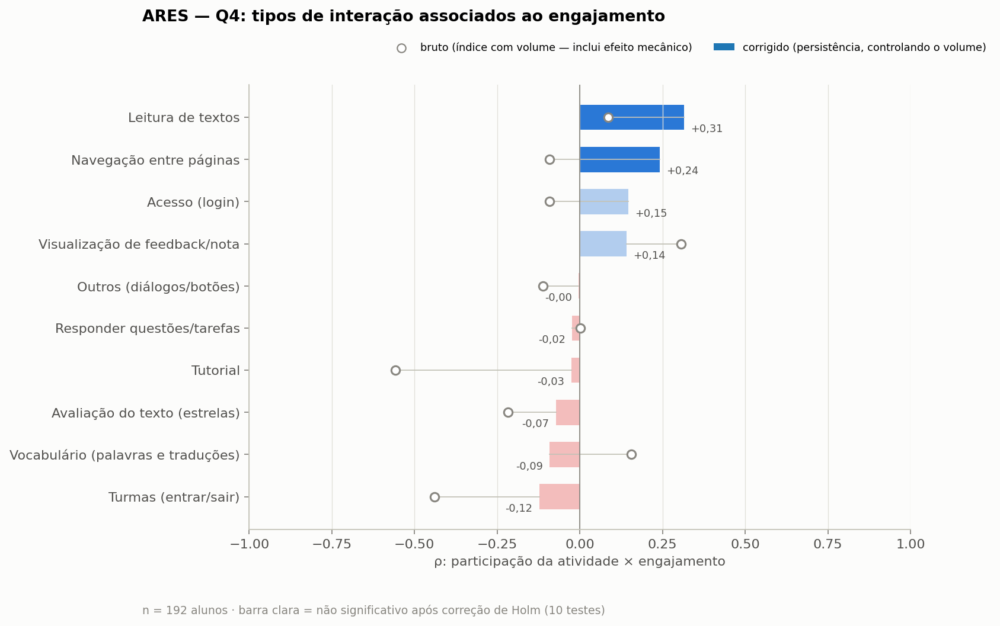

#### EdNet (n = 111.748 estudantes que foram além do diagnóstico)

| Atividade | ρ corrigido | ρ bruto (versão anterior) | % que usa: engajamento alto × baixo |
|---|---:|---:|---|
| **Aulas (vídeo/texto)** | **+0,24** | +0,57 | 85,3% × 8,8% |
| **Questões salvas (arquivo)** | **+0,24** | +0,42 | 52,6% × 3,9% |
| Caderno de erros/anotações | +0,17 | +0,31 | 71,5% × 18,2% |
| Revisão | +0,16 | +0,28 | 26,6% × 0,6% |
| Tutor | +0,15 | +0,24 | 22,3% × 0,6% |
| Quiz de revisão | +0,12 | +0,42 | 44,1% × 2,3% |
| Recomendação adaptativa | +0,09 | +0,65 | 88,3% × 8,9% |
| Leitura de explicações (feedback) | +0,06 | **+0,72** | 100% × 94,2% |
| Diagnóstico inicial | −0,10 | **−0,79** | 84,6% × 92,8% |
| Prática por parte (sprint) | −0,11 | +0,59 | 98,6% × 83,6% |

Todos os ρ do EdNet têm p < 0,001 (Holm), por causa do tamanho da base. A interpretação se baseia na magnitude: só aulas e questões salvas passam de “fraca” para perto de 0,25. Uso de **mobile** × engajamento (corrigido): ρ = 0,00 (desprezível). Esta é uma correção da versão anterior, que dizia que os engajados usavam mais a versão web.

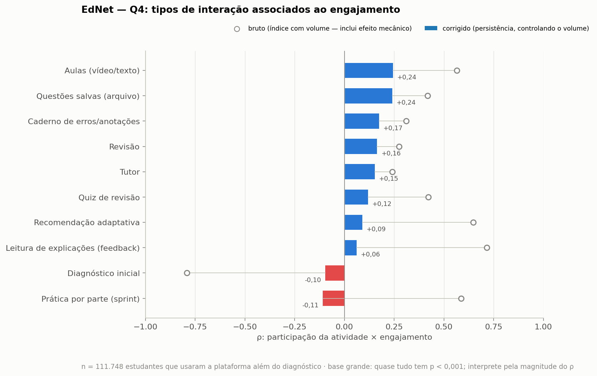

**Observação complementar — abandono pós-diagnóstico (EdNet, dado descritivo):** 186.167 estudantes (**62,5%**) só fizeram o diagnóstico (mediana de 20 eventos). A acurácia deles no diagnóstico (46,3%) é quase igual à de quem continuou (48,0%), então o desempenho no diagnóstico não parece explicar o abandono. Esse grupo tinha menos uso de mobile (58,3% × 83,3%). Os dados não mostram o *motivo* do abandono.

**Resposta (Q4):**
- **ARES:** com o efeito mecânico removido, dedicar mais do uso à **leitura de textos** (+0,31) e à **navegação** (+0,24) está associado a voltar mais vezes. Feedback, vocabulário, tutorial e turmas **não** têm associação significativa. As correlações fortes da versão anterior (tutorial −0,56, turmas −0,44, feedback +0,31) eram em boa parte efeito do cálculo.
- **EdNet:** as associações positivas mais fortes são **aulas** e **questões salvas** (+0,24), seguidas de caderno de erros, revisão e tutor (+0,15 a +0,17), todas **fracas**. Ler explicações e aceitar recomendações, que pareciam os comportamentos mais típicos dos engajados (+0,72 e +0,65), ficam **desprezíveis** quando se controla o volume. Elas acompanham o volume de uso; não são uma marca própria dos que persistem.
- Estes resultados são associações. Não mostram que fazer a atividade *causa* maior engajamento: alunos mais motivados podem simplesmente escolher mais conteúdo de estudo.

### 7.3 Q5 — Frequência de interação × evolução do desempenho

**Fórmulas (conferidas).** As duas bases medem a evolução de formas diferentes e **não comparáveis em escala**. Só a direção e a força da correlação podem ser comparadas.

| | ARES | EdNet |
|---|---|---|
| Fórmula | `nota_pos − nota_pre` | `acurácia(últimas 20) − acurácia(primeiras 20)`, **só questões fora do diagnóstico** |
| Escala | pontos, −11 a +11 | proporção, −1 a +1 (apresentada em p.p.) |
| Instrumento | Duas provas fixas de 12 itens (Q9 fora da nota). Os mesmos itens para todos | Questões diferentes para cada aluno, escolhidas pelo app |
| Tempo entre medidas | Pré em nov/2024, pós em jan/2025 | Varia por aluno (numa amostra de 3.000, mediana de ~20 dias entre as janelas da fórmula original; não medido na fórmula corrigida) |
| Quem entra | 141 alunos com as duas provas e log | 42.720 estudantes com ≥ 40 questões fora do diagnóstico (só quem usou bastante: viés de seleção) |
| Complementar | Ganho normalizado de Hake (instável: vai até −7 e fica indefinido com pré = 11) | `acurácia pós-diagnóstico − acurácia do diagnóstico` (n = 66.062) |

**Por que não comparar os números diretamente:**
- **As evoluções médias medem coisas diferentes.** No ARES, +0,71 ponto numa prova de 11 itens, com os mesmos itens para todos. No EdNet, +1,0 p.p. de acerto em questões diferentes para cada aluno, escolhidas pelo app. Uma não é “maior” que a outra.
- **Os ρ só se comparam em direção e ordem de grandeza.** Eles relacionam a frequência com variáveis de evolução diferentes, em populações e tamanhos diferentes (141 × 42.720). O que se pode dizer é que os dois são desprezíveis (|ρ| < 0,1), não que “o EdNet tem uma associação 0,04 maior”.

#### ARES (n = 141; evolução = pós − pré)

Média pré **4,75 → pós 5,46** (+0,71 ponto; Wilcoxon p = 0,011). 46,8% melhoraram, 14,2% ficaram iguais e 39,0% pioraram.

| Métrica | ρ com a evolução | ρ com o ganho normalizado | ρ parcial (controle do pré) |
|---|---:|---:|---:|
| Nº de interações | 0,00 (p = 0,99; IC95% −0,16 a +0,17) | −0,02 | +0,02 |
| Nº de sessões | +0,03 | +0,06 | +0,06 |
| Dias ativos | +0,01 | +0,01 | +0,03 |
| Nº de logins | +0,03 | +0,02 | −0,01 |

Evolução média por quartil de interação: +1,28 · −0,29 · +0,54 · +1,29 (Kruskal p = 0,10, ns). Alunos que melhoraram: 61% · 31% · 40% · 54%.

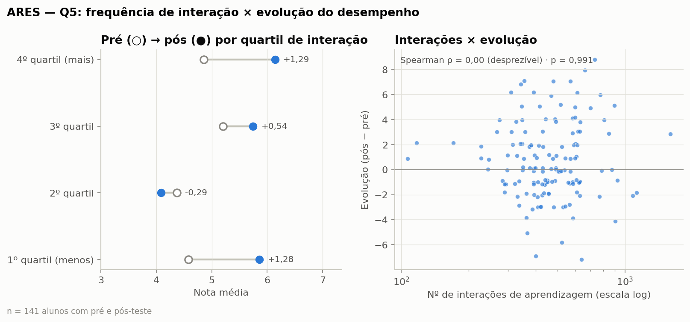

#### EdNet (n = 42.720; evolução = últimas 20 − primeiras 20 questões fora do diagnóstico)

**Quem entra na análise (fluxo de estudantes).** Os 297.915 são a base inteira, reprocessada por completo. Os 42.720 são o subconjunto que tem dados suficientes para calcular a evolução. São populações diferentes, e cada número usa o seu denominador:

| Etapa | Estudantes | Observação |
|---|---:|---|
| Base original (todos os arquivos do KT3, todos processados) | 297.915 | Denominador da descritiva e do “% que usa” da Q10 |
| Com ≥ 1 resposta final corrigível | 296.700 | |
| Com ≥ 1 resposta **fora do diagnóstico** | 102.691 | 62,5% da base só fez o diagnóstico |
| Com ≥ 40 respostas de qualquer origem | 46.635 | Amostra da fórmula **antiga** (não usada mais) |
| Com ≥ 40 respostas **fora do diagnóstico** | **42.720** | Necessário para ter 20 + 20 questões de prática |
| Com evolução calculada (amostra final da Q5) | **42.720** | Idêntico à linha anterior: nenhum caso perdido no cálculo |

Os filtros, as janelas e a exclusão do diagnóstico foram conferidos por recálculo independente (`src/auditoria.py`): n, médias e ρ conferem com os resultados oficiais. Como só entram estudantes que responderam ≥ 40 questões de prática, essa amostra é **mais engajada que a média** (viés de seleção), e o resultado não vale automaticamente para quem usa pouco.

Média início **63,6% → fim 64,6%** (**+1,0 p.p.**, mediana 0). 47,2% melhoraram, 42,1% pioraram e 10,7% ficaram iguais.

> **Correção:** a versão anterior usava as primeiras/últimas 20 respostas de *qualquer* origem e reportava 58,6% → 64,4% (+5,9 p.p., 58,5% melhoraram). Numa amostra de 3.000 alunos, **36% da janela inicial eram questões do diagnóstico** (mais difícil: 47% de acerto, contra 66% na prática), e quase nenhuma da janela final. A “evolução” comparava provas diferentes. Detalhes na §13, problema 2.

| Métrica | ρ | IC 95% | ρ parcial (controle do início) | ρ alternativo (pós-diagnóstico − diagnóstico, n = 66.062) |
|---|---:|---|---:|---:|
| Nº de interações | +0,04 | [+0,02; +0,05] | +0,06 | +0,07 |
| Nº de sessões | +0,02 | [+0,01; +0,04] | +0,01 | +0,04 |
| Dias ativos | +0,02 | [+0,01; +0,04] | 0,00 | +0,04 |

% que melhorou por quartil de interação: 45,5% · 46,6% · 46,8% · 49,8% (δ de Cliff 4º × 1º = 0,06, desprezível).

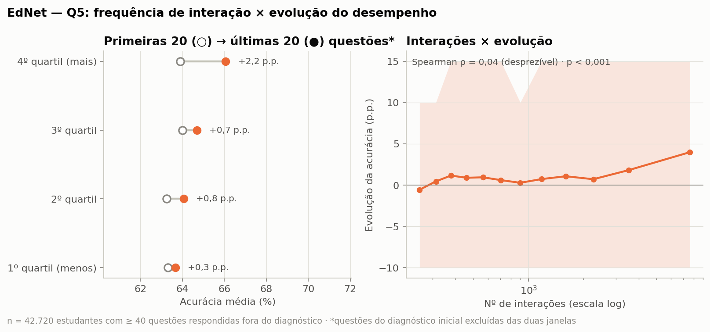

**Resposta (Q5):**
- **Observado:** a correlação entre frequência de interação e evolução é 0,00 no ARES e +0,04 no EdNet. Os valores são parecidos com qualquer fórmula e controlando o nível inicial.
- **Significância:** no ARES não é significativa (p = 0,99). No EdNet é (p < 0,001), mas **só por causa do tamanho da base** (n = 42.720).
- **Magnitude / relevância prática:** **desprezível nas duas** (|ρ| < 0,1). No EdNet, o 4º quartil de interação melhora em 49,8% dos casos, contra 45,5% no 1º (δ de Cliff = 0,06).
- **Conclusão:** **não há associação de relevância prática** entre interagir mais e evoluir mais. No ARES, o IC95% (−0,16 a +0,17) não permite descartar um efeito fraco. “Não detectado” não é o mesmo que “não existe”.
- **Cuidados:** nas duas bases há **regressão à média**: quem começa mais baixo tende a subir mais (ARES ρ(pré, evolução) = −0,32; EdNet −0,60). Por isso foi feita a análise parcial controlando o nível inicial. Controlar o nível inicial numa medida de *diferença* também tem limitações conhecidas (paradoxo de Lord), e por isso as duas versões (com e sem controle) são apresentadas. Elas concordam.

### 7.4 Q10 — Atividades mais usadas e sua relação com o desempenho

**Denominadores (conferidos).**
- **ARES:** “% dos eventos” = sobre os **87.391 eventos de aprendizagem** dos 192 alunos, sem alertas do sistema. “% alunos que usam” = sobre os **192** alunos com log. As correlações usam os **141** com pré, pós e log.
- **EdNet:** as **8 origens** formam uma partição dos eventos: somam exatamente os 89.194.876 eventos (conferido). **Explicações e aulas são *acessos*** (eventos de entrada), que **já estão contados** dentro de alguma origem. Por isso não têm “% dos eventos” e não podem ser somados às origens.
- **EdNet, “% estudantes que usam”:** é dado sobre os **297.915** estudantes e também sobre os **111.748 ativos** (que foram além do diagnóstico). Sobre todos os estudantes, a prática parece usada por só 33%. Entre os ativos, são **89%**.

**Controles.** ρ parcial controlando o nível inicial (pré-teste/diagnóstico), e uma segunda versão que **também controla o volume total**, para separar “esta atividade” de “usar mais a plataforma”. No ARES, os p-valores foram corrigidos para 10 testes (Holm).

#### ARES

| Atividade | % dos eventos | % alunos que usam (192) | ρ parcial (controle do pré) | p | p (Holm) | ρ parcial (pré + volume) |
|---|---:|---:|---:|---:|---:|---:|
| Responder questões/tarefas | **47,8%** | 100% | +0,04 | 0,65 | 1,00 | −0,02 |
| Navegação entre páginas | 14,2% | 100% | −0,04 | 0,65 | 1,00 | −0,11 |
| Vocabulário (palavras e traduções) | 11,8% | 96,9% | +0,17 | 0,042 | **0,38 (ns)** | +0,16 |
| Leitura de textos | 10,8% | 100% | −0,03 | 0,72 | 1,00 | −0,10 |
| Avaliação do texto (estrelas) | 7,1% | 100% | −0,06 | 0,51 | 1,00 | −0,08 |
| Acesso (login) | 2,6% | 100% | 0,00 | 0,96 | 1,00 | −0,04 |
| Outros (diálogos/botões) | 2,1% | 96,9% | +0,04 | 0,63 | 1,00 | +0,02 |
| Turmas (entrar/sair) | 2,1% | 100% | −0,02 | 0,80 | 1,00 | −0,03 |
| Tutorial | 0,9% | 100% | −0,23 | 0,005 | **0,054 (limite)** | −0,24 (Holm 0,047) |
| Visualização de feedback/nota | 0,6% | **22,4%** | −0,04 | 0,62 | 1,00 | −0,06 |

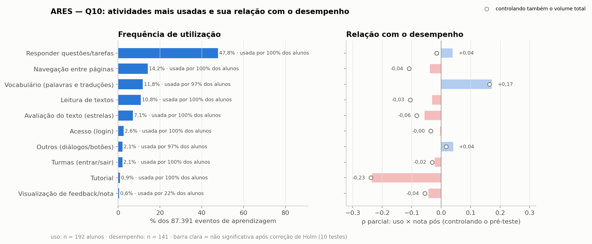

#### EdNet

| Atividade | Tipo | % dos eventos | % estudantes que usam (todos / ativos) | Acurácia dentro da atividade | ρ parcial (controle do diagnóstico) | ρ parcial (diagnóstico + volume) |
|---|---|---:|---:|---:|---:|---:|
| **Prática por parte (sprint)** | origem | **72,4%** | 33,3% / **88,9%** | 66,4% | **+0,16** | **+0,10** |
| Leitura de explicações | acessos | (15,9 mi acessos) | 36,3% / 96,7% | — | +0,14 | +0,02 |
| Caderno de erros/anotações | origem | 7,9% | 13,5% / 36,1% | 63,1% | +0,04 | −0,05 |
| Diagnóstico inicial | origem | 7,4% | 96,1% / 89,7% | 47,4% | −0,05 | −0,05 |
| Recomendação adaptativa | origem | 5,7% | 15,0% / 39,9% | 78,1% | +0,01 | −0,16 |
| Quiz de revisão | origem | 4,1% | 6,2% / 16,5% | 73,7% | +0,08 | +0,01 |
| Revisão | origem | 0,9% | 4,4% / 11,9% | 77,9% | +0,04 | +0,01 |
| Tutor | origem | 0,8% | 3,7% / 9,8% | 63,4% | +0,03 | −0,01 |
| Questões salvas (arquivo) | origem | 0,7% | 7,9% / 21,0% | — | +0,08 | +0,01 |
| Aulas (vídeo/texto) | acessos | (0,6 mi acessos) | 14,4% / 38,3% | — | +0,04 | −0,10 |

(n = 66.062 estudantes com diagnóstico ≥ 5 questões e ≥ 10 questões depois. Com essa base, até ρ de ±0,01 pode ter p < 0,05; interprete pela magnitude.)

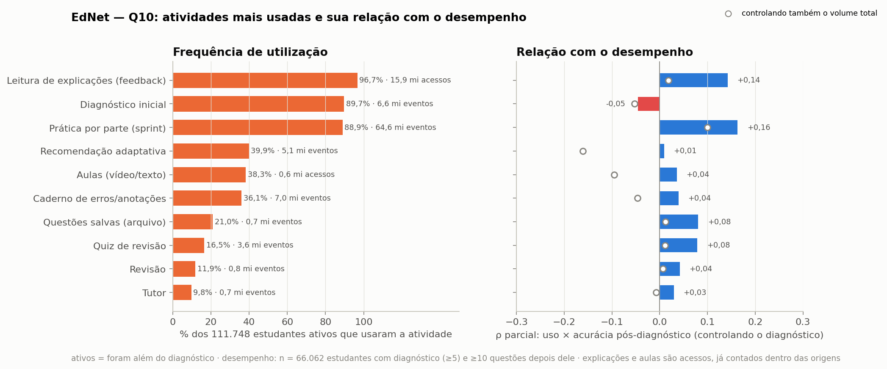

**Resposta (Q10):**
- **ARES:** a atividade mais usada é **responder questões/tarefas** (48% dos eventos, 100% dos alunos). **Nenhuma atividade** tem relação significativa com a nota depois de corrigir para os 10 testes. Vocabulário (+0,17), que a versão anterior destacava, tem p ajustado = 0,38. Reabrir o tutorial (−0,23) fica no limite (p ajustado = 0,054; 0,047 controlando também o volume, ou seja, “significativo” numa especificação e não na outra). Pode ser um sinal de alunos com dificuldade de uso, mas é uma **hipótese**, não um resultado firme.
- **EdNet:** a atividade mais usada é a **prática por parte** (72% dos eventos, 89% dos ativos). Ela também tem a maior relação com o desempenho, **fraca** (+0,16), que se mantém em parte (+0,10) quando se controla o volume. A leitura de explicações (+0,14) **some** com esse controle (+0,02): ela acompanha o volume de prática, mas não acrescenta associação própria. A recomendação adaptativa tem a maior acurácia interna (78%), porque oferece questões calibradas para o aluno; isso não indica que ela melhore o desempenho.

---

## 8. Comparação entre os datasets

### 8.1 Tabela comparativa

Para Q4 e Q10, as atividades foram pareadas pela **mesma função pedagógica**:

| Função | ARES | EdNet |
|---|---|---|
| Responder questões | Responder questões/tarefas | Prática por parte (sprint) |
| Ver feedback/explicação | Visualização de feedback/nota | Leitura de explicações |
| Estudar conteúdo | Leitura de textos | Aulas (vídeo/texto) |
| Recursos de apoio/revisão | Vocabulário (palavras e traduções) | Caderno de erros/anotações |
| Atividade de entrada | Tutorial | Diagnóstico inicial |

| Pergunta | Medida | ARES (ρ) | EdNet (ρ) | Conclusão |
|---|---|---:|---:|---|
| Q1 | Nº de interações | +0,08 | +0,15 | Parcialmente convergente |
| Q1 | Nº de sessões | +0,08 | +0,08 | Convergente (sem efeito nas duas) |
| Q1 | Dias ativos | +0,04 | +0,07 | Convergente (sem efeito nas duas) |
| Q5 | Nº de interações | 0,00 | +0,04 | Convergente (sem efeito nas duas) |
| Q5 | Nº de sessões | +0,03 | +0,02 | Convergente (sem efeito nas duas) |
| Q5 | Dias ativos | +0,01 | +0,02 | Convergente (sem efeito nas duas) |
| Q4 | Responder questões | −0,02 | −0,11 | Parcialmente convergente |
| Q4 | Ver feedback/explicação | +0,14 (ns) | +0,06 | Convergente (sem efeito nas duas) |
| Q4 | **Estudar conteúdo** | **+0,31** | **+0,24** | **Convergente** |
| Q4 | Recursos de apoio/revisão | −0,09 (ns) | +0,17 | Parcialmente convergente |
| Q4 | Atividade de entrada | −0,03 (ns) | −0,097 | Convergente (sem efeito nas duas) |
| Q10 | Responder questões | +0,04 (ns) | +0,16 | Parcialmente convergente |
| Q10 | Ver feedback/explicação | −0,04 (ns) | +0,14 | Parcialmente convergente |
| Q10 | Estudar conteúdo | −0,03 (ns) | +0,04 | Convergente (sem efeito nas duas) |
| Q10 | Recursos de apoio/revisão | +0,17 (ns após Holm) | +0,04 | Convergente (sem efeito nas duas) |
| Q10 | Atividade de entrada | −0,23 (Holm 0,054) | −0,05 | Convergente (sem efeito nas duas) |

*Critério (revisado):* um efeito só conta quando |ρ| ≥ 0,1 **e** p < 0,05. Nas comparações de várias atividades (Q4, Q10), o p do ARES é o corrigido por Holm. “Convergente” = mesmo sinal nas duas bases. “Parcialmente” = efeito em uma base e não na outra. “Divergente” = sinais opostos (não houve nenhum caso). A versão anterior ignorava a significância e contava, por exemplo, o +0,16 não ajustado do vocabulário como efeito.

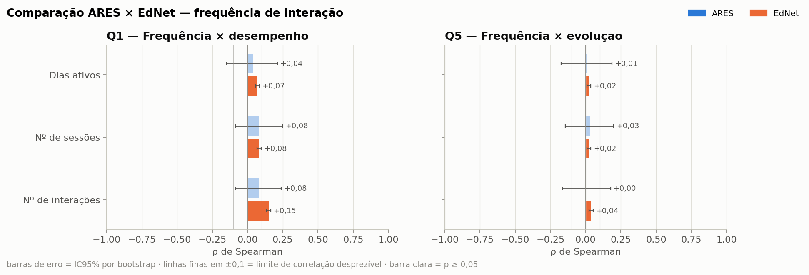

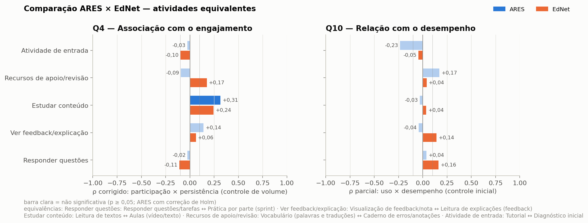

### 8.2 Interpretação da comparação

1. **Nenhum resultado é divergente.** Quando as bases discordam, é porque o efeito aparece no EdNet e não no ARES, nunca em sentidos opostos. Parte disso é tamanho de amostra: o EdNet detecta efeitos de 0,04 que o ARES (n = 141) não teria como detectar.
2. **Q5 é a conclusão mais robusta:** nas duas plataformas, com fórmulas e escalas diferentes e tamanhos muito diferentes (141 × 42.720), **não há associação relevante entre interagir mais e evoluir mais**.
3. **Q1 difere pouco.** No EdNet a associação é fraca (0,15; 0,14 controlando o diagnóstico) e só é detectada por causa do tamanho da base. No ARES ela não foi detectada (0,08, IC95% até +0,24), o que é compatível com um efeito fraco do mesmo tamanho. No ARES todos os alunos seguiram o mesmo roteiro de curso, e a frequência varia pouco (mediana de 9 dias ativos, IQR 7–11). No EdNet o uso é livre e varia de 1 a 413 dias.
4. **Q4 converge em um ponto:** dedicar mais do uso a **conteúdo de estudo** (textos no ARES, aulas no EdNet) está associado a voltar mais vezes. A conclusão da versão anterior (“ver feedback/explicação marca os engajados”) **não se sustenta** depois de remover o efeito mecânico.
5. **Q10:** nas duas bases, a relação entre atividades e desempenho é **fraca ou inexistente**. No ARES nenhuma atividade é significativa após a correção. No EdNet só a prática mantém uma associação fraca além do volume de uso.

---

## 9. Fase 6 — Implantação: recomendações para o site

> **Importante:** nenhuma análise deste trabalho mostra que uma interação *causa* melhor aprendizagem ou engajamento. As recomendações estão agrupadas pela **origem da evidência** e são **hipóteses a testar** no Beready, de preferência com teste A/B (um grupo com a mudança, outro sem) e a métrica indicada.

**A. Apoiadas em associação observada nas duas bases**

| # | Recomendação (hipótese) | Evidência | Força | Como testar |
|---|---|---|---|---|
| 1 | **Não usar volume de cliques ou tempo de tela como meta de sucesso**; medir aprendizagem (pré/pós) | Q1: associação fraca (EdNet 0,15) ou não detectada (ARES). Q5: desprezível nas duas bases | **Moderada**: resultado nulo/fraco convergente, com n grande | Comparar a evolução pré/pós com a atividade |
| 2 | **Dar destaque ao conteúdo de estudo** (textos, aulas) no caminho do aluno | Q4 corrigida: +0,31 (ARES, significativo) e +0,24 (EdNet, fraco) | **Fraca a moderada**: associação, sem causa | A/B: destaque de conteúdo × layout atual; medir retorno (dias ativos) |

**B. Apoiadas em observação descritiva (o tamanho do problema, não a solução)**

| # | Recomendação (hipótese) | Evidência | Força | Como testar |
|---|---|---|---|---|
| 3 | **Atacar o abandono logo após a atividade de entrada** (nivelamento/tutorial): levar o aluno direto para a primeira atividade de estudo | 62,5% dos estudantes do EdNet não passaram do diagnóstico. A acurácia no diagnóstico deles (46%) era parecida com a de quem continuou (48%) | **Descritiva**: não sabemos a causa do abandono | % que volta após a 1ª sessão, antes × depois da mudança |
| 4 | **Instrumentar o Beready desde o início:** log de eventos no padrão xAPI e pré/pós-avaliação curta | Foi o que permitiu responder Q1/Q5 no ARES | Pré-requisito para testar as demais | — |

**C. Hipóteses exploratórias (evidência fraca ou de uma base só): investigar antes de priorizar**

| # | Hipótese | Evidência | Por que é fraca |
|---|---|---|---|
| 5 | Recursos de revisão (caderno de erros, questões salvas, revisão) ajudam a reter alunos | Q4 EdNet: +0,16 a +0,24 (corrigido) | Só uma base; associação fraca |
| 6 | Alunos que reabrem o tutorial muitas vezes podem estar com dificuldade | ARES Q10: −0,23 | p ajustado no limite (0,054 / 0,047, conforme a especificação) |

**Retiradas na revisão** (não sustentadas pelos resultados corrigidos):
- “Mostrar feedback/explicação após cada resposta aumenta o engajamento”: a associação desaparece ao remover o efeito mecânico (ARES +0,14 ns; EdNet +0,06). Que só 22% dos alunos do ARES tenham aberto o feedback é um **dado descritivo**. Ele pode motivar uma melhoria de usabilidade, mas não há evidência de efeito sobre aprendizagem.
- “Recomendação adaptativa aumenta o engajamento”: +0,65 na versão anterior, +0,09 corrigido.
- “Cuidar da experiência mobile”: associação corrigida = 0,00.
- “Vocabulário melhora o desempenho”: não significativo após Holm (p = 0,38).

---

## 10. Limitações e validade

- **Correlação não é causalidade.** Todos os resultados são associações. Por exemplo, alunos mais motivados podem tanto estudar mais conteúdo quanto voltar mais vezes, sem que uma coisa cause a outra. Testes A/B no site são o próximo passo.
- **Associações mecânicas.** Índices que contêm a mesma variável que se correlaciona com eles geram correlações artificiais. A Q4 foi refeita para evitar isso (§13, problema 1). O controle do volume total é uma correção estatística, não um experimento.
- **Múltiplas comparações.** Com 10 atividades por base, alguns p < 0,05 aparecem por acaso. No ARES foi aplicada a correção de Holm.
- **ARES é pequeno (n = 141).** Só detecta correlações a partir de |ρ| ≈ 0,24. Efeitos fracos podem existir sem serem detectados. “Não detectado” não é o mesmo que “não existe”.
- **EdNet não tem pré/pós-teste.** O desempenho é a acurácia nas questões do próprio app, escolhidas de forma adaptativa (a dificuldade muda com o aluno). O diagnóstico funciona como *proxy* de pré-teste. A evolução na Q5 compara questões diferentes e só inclui quem respondeu pelo menos 40 questões fora do diagnóstico (viés de seleção).
- **Na base grande, p-valores não informam.** Por isso as conclusões do EdNet se baseiam no tamanho do efeito (ρ, δ de Cliff).
- **Escolhas metodológicas documentadas:** sessão = 30 min de inatividade; leitura acima de 60 min descartada; mínimo de 10 questões para medir desempenho; janela de 20 questões para evolução. Os valores estão centralizados em `src/config.py`.
- **Categorias de atividade do ARES** foram definidas por regras sobre os descritores dos botões e diálogos (§5.1.4). Outra categorização poderia mudar resultados marginais.
- **Populações diferentes:** alunos de leitura em inglês (ARES) × candidatos ao TOEIC na Coreia (EdNet). Isso reforça os achados convergentes, mas exige cautela com os específicos.

---

## 11. Reprodutibilidade

### Estrutura do repositório

```
Datasets-Beready/
├── README.md
├── requirements.txt
├── run_all.py                    ← executa tudo na ordem (--notebooks: executa também os notebooks)
├── notebooks/01…09_*.ipynb       ← o passo a passo deste documento, executado
├── docs/DOCUMENTACAO.md          ← este documento
├── docs/SINTESE_APRESENTACAO.md  ← apoio para os slides
├── src/
│   ├── config.py                 ← caminhos e parâmetros metodológicos
│   ├── utils.py                  ← estatística + estilo dos gráficos
│   ├── ares_01_prepare.py        ← Fase 2/3 ARES
│   ├── ares_02_analise.py        ← Fase 4/5 ARES (Q1, Q4, Q5, Q10)
│   ├── ednet_01_extract.py       ← Fase 2/3 EdNet (297.915 arquivos, paralelo)
│   ├── ednet_02_analise.py       ← Fase 4/5 EdNet (Q1, Q4, Q5, Q10)
│   ├── comparacao.py             ← Fase 5 comparação
│   └── auditoria.py              ← revisão: Pearson × Spearman (Q1), fórmulas da Q5, consistência
├── data/
│   ├── raw/ares/                 ← dados do OSF (baixados)
│   └── processed/                ← bases limpas (1 linha por aluno)
└── outputs/
    ├── figures/{ares,ednet,comparacao}/
    └── tables/                   ← qualidade (*.json), resultados (*.json, *.csv), comparacao.md
```

O EdNet bruto (cerca de 763 MB zipado ou 3,5 GB descompactado) **não vai para o repositório**. O `src/config.py` aceita os dois formatos:

| | Aceito como |
|---|---|
| **KT3** | `EdNet-KT3.zip` **ou** pasta `EdNet-KT3/` com os `u*.csv` (direto ou dentro de `EdNet-KT3/KT3/`) **ou** pasta `KT3/` |
| **Contents** | `contents/questions.csv` **ou** `EdNet-Contents/contents/questions.csv` **ou** `EdNet-Contents/questions.csv` |

Pastas procuradas, nesta ordem: (1) variável de ambiente `EDNET_DIR`; (2) `data/raw/ednet` dentro do projeto (ignorada pelo git); (3) `Datasets/` dentro do projeto ou ao lado dele, o layout usado no `Proj_mineracoa` (`Datasets/EdNet-KT3` + `Datasets/EdNet-Contents`); (4) `../Datasets-Beready-raw/ednet` e `~/Datasets-Beready-raw/ednet`. O notebook 01 (seção 5) mostra onde o projeto procurou e o que encontrou.

**Exemplo:** se os dados estão em `Proj_mineracoa\Datasets\EdNet-KT3` e `Proj_mineracoa\Datasets\EdNet-Contents`, basta copiar ou mover as duas pastas para `data/raw/ednet/` do projeto, ou, no PowerShell, antes de rodar: `$env:EDNET_DIR = "C:\caminho\Proj_mineracoa\Datasets"`.

**Sem o EdNet bruto, o projeto continua executável.** O `run_all.py` detecta a ausência, avisa e pula a extração. As análises usam `data/processed/ednet_users.csv.gz`, que já vem processado no repositório. Só é preciso baixar o bruto para *regenerar* esse arquivo.

### Como executar

```bash
pip install -r requirements.txt

# 1) ARES (OSF 8y3zp)
curl -L -o ares.zip "https://files.osf.io/v1/resources/8y3zp/providers/osfstorage/?zip="
unzip ares.zip -d data/raw/ares

# 2) EdNet KT3 + Contents — OPCIONAL (só para regenerar data/processed/ednet_users.csv.gz)
#    Links do README oficial github.com/riiid/ednet
mkdir -p data/raw/ednet && cd data/raw/ednet
python -m gdown "https://drive.google.com/uc?id=1TVyGIWU1Mn3UCjjeD6bcZ57YspByUV7-"   # EdNet-KT3.zip (não descompactar)
python -m gdown "https://drive.google.com/uc?id=117aYJAWG3GU48suS66NPaB82HwFj6xWS"   # EdNet-Contents.zip
unzip EdNet-Contents.zip   # gera contents/questions.csv
cd ../../..

# 3) Pipeline
python run_all.py                        # completo (~10–12 min com a extração do EdNet)
python run_all.py --skip-ednet-extract   # reaproveita a extração (~1–2 min)
# Ao final, auditoria.py imprime "Recálculo independente: 93/93 verificações conferem."
# Se alguma divergir, o run_all termina com erro.
```

### Arquivos de saída principais

| Arquivo | Conteúdo |
|---|---|
| `outputs/tables/ares_qualidade.json` | Cada passo de limpeza/validação do ARES com contagens |
| `outputs/tables/ednet_qualidade.json` | Linhas brutas, nulos, duplicadas e inválidos do EdNet |
| `outputs/tables/ares_resultados.json` / `ednet_resultados.json` | Todas as estatísticas de Q1, Q4, Q5 e Q10 |
| `outputs/tables/*_Q4_*.csv`, `*_Q10_*.csv` | Tabelas por atividade |
| `outputs/tables/comparacao.json` / `comparacao.md` | Comparação ARES × EdNet |
| `outputs/tables/auditoria.json` | Reprodução do r = 0,118, comparação das fórmulas de evolução e checagens de consistência (§13) |
| `data/processed/ares_alunos.csv` | 192 alunos × atributos |
| `data/processed/ednet_users.csv.gz` | 297.915 estudantes × 48 atributos |

---

## 12. Glossário

| Termo | Significado |
|---|---|
| **CRISP-DM** | Processo padrão de mineração de dados em 6 fases |
| **xAPI** | Padrão de registro de experiências de aprendizagem (“ator — verbo — objeto”) |
| **Sessão** | Sequência de eventos sem pausa maior que 30 min |
| **Acurácia** | % de questões respondidas corretamente (resposta final) |
| **Ganho normalizado (Hake)** | (pós − pré) / (máximo − pré) |
| **ρ de Spearman** | Correlação por postos, de −1 a +1 |
| **ρ parcial** | Correlação depois de remover o efeito de uma terceira variável (o nível inicial) |
| **IC 95%** | Faixa em que o valor verdadeiro está com 95% de confiança |
| **δ de Cliff** | Tamanho de efeito entre dois grupos (−1 a +1). \|δ\| ≥ 0,47 é grande |
| **Regressão à média** | Quem tira nota extrema numa medida tende a ficar mais perto da média na seguinte |
| **Diagnóstico (EdNet)** | Teste inicial de nivelamento do app Santa |

---

## 13. Revisão metodológica (registro de correções)

Duas auditorias em 11/10/2026: problemas 1–5 na primeira e 6–8 na segunda. Todos os números foram **recalculados**; nada foi estimado. A reprodução está em `src/auditoria.py` (saída: `outputs/tables/auditoria.json`). As correções foram incorporadas às análises principais. Dentro de cada auditoria, os problemas estão em ordem de impacto nas conclusões.

### Problema 1 — Q4: associação mecânica entre o índice de engajamento e as atividades *(maior impacto)*

**O que estava errado.** O índice de engajamento era a média dos percentis de **nº de interações**, sessões, dias ativos e tempo. A medida de cada atividade era a **participação dela no total de interações**. Como o total está dos dois lados da correlação:
- Atividades de contagem quase fixa (tutorial no ARES, cerca de 3 eventos; diagnóstico no EdNet, cerca de 25) têm participação ≈ k ÷ total. Ela cai sozinha quando o total sobe: ρ(participação, total) = −0,72 no tutorial e −0,82 no diagnóstico. Isso produziu os “fortes negativos” −0,56 e −0,79.
- Atividades que acompanham o volume (explicação do EdNet, aberta após cada questão: ρ(contagem, total) = 0,99) produziram “fortes positivos” (+0,72).

**Como corrigir.** (a) Medir engajamento só por **persistência** (sessões + dias ativos), que não é soma das atividades. (b) Usar **correlação parcial controlando o log do volume total**. (c) Corrigir os p-valores para 10 testes (Holm).

```python
# src/utils.py — q4_tabela()
d["_it"] = engagement_index(d, ["n_sessoes", "dias_ativos"])         # persistência
share = d[c] / total                                                    # participação da atividade
k = partial_spearman(share, d["_it"], np.log(d[n_col]))                 # controla o volume
t["p_corrigido_holm"], t["p_corrigido_bh"] = ajuste_multiplo(t["p_corrigido"])
```

**Conclusão corrigida (em linguagem simples).** Tirando o efeito do cálculo, quem dedica mais do seu uso a **estudar conteúdo** (ler textos no ARES, ver aulas no EdNet) tende a voltar mais vezes à plataforma, nas duas bases (+0,31 e +0,24). “Ver feedback/explicação” e “ficar no tutorial/diagnóstico” **não** são marcas fortes de engajamento, ao contrário do que dizia a versão anterior. Isso é uma associação, não prova de causa.

### Problema 2 — Q5 (EdNet): a fórmula de evolução misturava o diagnóstico com a prática

**O que estava errado.** A evolução era a acurácia nas últimas 20 menos nas primeiras 20 respostas, **de qualquer origem**. Numa amostra aleatória de 3.000 estudantes, **36% da janela inicial eram questões do diagnóstico** (nivelamento mais difícil: 47% de acerto, contra 66% na prática), e só 0,5% da janela final. A “melhora” de +5,9 p.p. vinha em boa parte de comparar provas diferentes.

**Como corrigir.** Calcular as duas janelas **só com respostas fora do diagnóstico**. Isso exigiu reprocessar os 297.915 arquivos. As colunas antigas foram conferidas e ficaram idênticas, e apenas duas foram acrescentadas.

```python
# src/ednet_01_extract.py
c_nd = correct[fsrc != "diagnosis"]
if len(c_nd) >= 2 * W:
    row["acuracia_inicio_sem_diag"] = round(float(c_nd[:W].mean()), 4)
    row["acuracia_fim_sem_diag"] = round(float(c_nd[-W:].mean()), 4)
```

**Diferenças entre as fórmulas do ARES e do EdNet:** ver a tabela da §7.3. As escalas são diferentes (pontos × proporção), os instrumentos também (prova fixa × questões adaptativas), e só a força/direção da correlação é comparável.

**Conclusão corrigida.** A evolução média no EdNet é pequena (**+1,0 p.p.**, mediana 0; 47% melhoram e 42% pioram), não +5,9 p.p. A associação entre frequência de interação e evolução continua **desprezível** (ρ = +0,04) e a conclusão da Q5 se mantém: **interagir mais não está associado a evoluir mais**, em nenhuma das bases. No ARES (ρ = 0,00; IC95% −0,16 a +0,17), um efeito fraco não pode ser descartado.

### Problema 3 — Q10: múltiplos testes, efeito de volume e denominadores

**O que estava errado.**
1. **ARES:** 10 atividades testadas, sem correção. O destaque “vocabulário +0,17 (p = 0,042)” **não sobrevive** à correção de Holm (p = 0,38). O tutorial (p = 0,005) fica no limite (p ajustado = 0,054).
2. **EdNet:** o uso de cada atividade foi correlacionado com o desempenho controlando só o diagnóstico. Atividades usadas por quem usa muito a plataforma herdam a associação do volume (Q1). A **leitura de explicações** (+0,14) cai para **+0,02** quando o volume também é controlado.
3. **Denominadores:**
   - “% estudantes que usam” do EdNet era sobre todos os 297.915, inclusive os 62,5% que só fizeram o diagnóstico. Por isso a prática aparecia como usada por só 33%, quando entre os ativos são **89%**.
   - O gráfico também ordenava, na mesma escala, *eventos* de origens (uma partição que soma 89.194.876, o que foi conferido) e *acessos* a explicações e aulas, que já estão contados dentro das origens.

**Como corrigir.** Correção de Holm no ARES. Uma segunda correlação parcial controlando também o volume. Percentual sobre ativos. Coluna “tipo” separando origens de acessos.

```python
# src/ares_02_analise.py — q10()
rv = partial_spearman(perf[c], perf["nota_pos"], pd.DataFrame({"pre": perf["nota_pre"],
                                                               "log_volume": np.log(perf["n_interacoes"])}))
t["p_parcial_holm"], t["p_parcial_bh"] = ajuste_multiplo(t["p_parcial"])
# src/ednet_02_analise.py — q10()
"pct_estudantes_ativos_que_usam": round(float((ativos[c] > 0).mean() * 100), 1),
```

**Conclusão corrigida.** A atividade mais usada é responder questões/praticar, nas duas bases. A relação das atividades com o desempenho é **fraca ou inexistente**. No ARES, nenhuma é significativa depois da correção. No EdNet, só a prática mantém uma associação fraca (+0,10) além de “usar mais a plataforma”.

### Problema 4 — Q1: Pearson (r = 0,118, notebook antigo) × Spearman (ρ = 0,08, documentação)

**O que precisava ser conferido.** Se os dois números vinham dos mesmos dados e critérios. O notebook `Test2_8y3zp.ipynb` (célula 41) calculou Pearson entre `num_interacoes` e `post_score` com:
- **todos** os eventos do xAPI, inclusive as 2.184 duplicatas, as próprias provas, os questionários e os erros do sistema;
- nota = soma das **12** questões (0–12, incluindo a Q9, que não entra na nota oficial).

**O que a auditoria mostrou.** São **os mesmos 141 alunos**. Medindo cada critério separadamente:

| Cenário | Pearson r | p | Spearman ρ | p |
|---|---:|---:|---:|---:|
| A — notebook antigo (todos os eventos, com duplicatas, nota 0–12) | **0,118** | 0,16 | 0,100 | 0,24 |
| B — A + nota oficial 0–11 | 0,094 | 0,27 | 0,084 | 0,32 |
| C — B + sem duplicatas | 0,121 | 0,15 | 0,089 | 0,29 |
| D — C + só eventos de aprendizagem (**documentação**) | **0,115** | 0,17 | **0,079** | 0,35 |
| D com log(interações), Pearson | 0,075 | 0,38 | — | — |
| D sem os 4 outliers | 0,100 | 0,24 | 0,072 | 0,40 |

A diferença **0,118 × 0,08 vem principalmente do método** (com os mesmos dados limpos: Pearson 0,115 × Spearman 0,079), não da limpeza. O Pearson fica mais alto porque o nº de interações é muito assimétrico (assimetria = 1,9; Shapiro p < 0,001) e alguns alunos com muitas interações puxam a reta. Com o log das interações, o Pearson cai para 0,075.

**Qual apresentar.** **Spearman como resultado principal** (variável assimétrica, com outliers e sem normalidade), com **Pearson como análise de sensibilidade**. Em todos os cenários o p fica acima de 0,15 e o IC95% inclui zero. Para detectar r = 0,118 com 80% de poder seriam necessários cerca de 560 alunos.

**Conclusão corrigida.** Não muda: **no ARES não foi detectada associação** entre frequência de interação e nota, com qualquer coeficiente. O notebook antigo e a documentação concordam; só usam coeficientes diferentes.

### Problema 5 — Consistência entre código, tabelas, gráficos e texto

**O que foi conferido.**
- As tabelas JSON/CSV e as figuras foram geradas **depois** dos dados processados atuais. O script verifica as datas e não encontrou nenhuma saída desatualizada.
- O ρ da Q1 do ARES no JSON confere com um recálculo direto a partir de `ares_alunos.csv`.
- A nota do pré-teste confere 100% com o recálculo (Q9 excluída).
- A nova função de correlação parcial com vários controles reproduz exatamente os valores anteriores com um controle (ex.: Q1 ARES +0,0576).
- As origens do EdNet somam exatamente o total de eventos.

**Inconsistências encontradas e corrigidas.**
- A regra de “convergência” da comparação ignorava a significância (contava como efeito o +0,16 não significativo do ARES). Agora exige |ρ| ≥ 0,1 e p < 0,05, com Holm onde há vários testes. Nos gráficos de comparação, as barras não significativas aparecem claras.
- O texto da Q4 citava “mobile × engajamento = −0,14” como recomendação. Com o índice corrigido, o valor é 0,00 e a recomendação foi retirada.
- As conclusões e recomendações usavam linguagem causal (“o que distingue”, “marca os engajados”). Elas foram reescritas separando **observado / associação / hipótese** (§1 e §9).

### Problema 6 — Q1 (EdNet): a acurácia misturava o diagnóstico com a prática *(2ª auditoria)*

**O que estava errado.** O desempenho da Q1 era a acurácia em **todas** as respostas. A proporção de questões do diagnóstico (mais difíceis) depende do próprio volume de uso: mediana de **100%** das respostas no 1º quartil de interação, 50% no 2º, 20% no 3º e **3%** no 4º (ρ entre interações e % de diagnóstico = −0,93). Quem usava pouco era avaliado quase só em questões difíceis, o que inflava a correlação para 0,36. É o mesmo tipo de erro corrigido na Q5 (problema 2).

**Como corrigir.** Medir o desempenho só nas questões **fora do diagnóstico** (≥ 10), a mesma variável já usada na análise parcial. A coluna de correlação bruta da Q10 foi corrigida da mesma forma.

```python
# src/ednet_02_analise.py
perf = u.dropna(subset=["acuracia_pos_diag"]).copy()      # acurácia fora do diagnóstico, ≥ 10 questões
out["correlacoes"][c] = spearman(perf[c], perf["acuracia_pos_diag"])
```

**Conclusão corrigida.** A associação entre frequência de interação e desempenho no EdNet é **fraca (ρ = 0,15; n = 76.252)**, não moderada. Ela praticamente não muda ao controlar o diagnóstico (0,14), o que mostra que a análise parcial já estava medindo a coisa certa. Sessões e dias ativos têm associação desprezível (0,08 e 0,07). Com isso, ARES (0,08, não significativo) e EdNet (0,15, fraco) ficam mais próximos do que pareciam.

### Problema 7 — O projeto não rodava em outro computador *(2ª auditoria)*

**O que estava errado.** O caminho do EdNet estava fixo na pasta do autor (`C:\Users\braia\...`). Em outra máquina, o `run_all.py` parava com `FileNotFoundError` na extração do EdNet, mesmo com o arquivo processado disponível. Os acentos também saíam corrompidos no console do Windows (`quest�es`).

> Os sinais `~~~~^^^^` no traceback **não são um erro**. Desde o Python 3.11, eles só sublinham o trecho da linha que falhou. A mensagem de erro é sempre a última linha.

**Como corrigir.** `config.py` procura o EdNet em locais portáveis (§11). `run_all.py` pula a extração com aviso quando só existe o processado, força UTF-8 nos subprocessos e encerra com mensagem clara se uma etapa falhar.

**Verificado por execução**, com Python 3.14.7 (a versão do colega) numa cópia do projeto em um caminho com acento (`...\Usuário\...`):
- **Cenário A, sem o EdNet bruto:** a extração foi pulada com aviso, as demais etapas concluíram e a auditoria deu 93/93.
- **Cenário B, do zero:** sem `data/processed` e `outputs`, com o EdNet bruto disponível, tudo foi regenerado: extração dos 297.915 arquivos em 483 s, análises, 13 gráficos e auditoria 93/93. Os dados processados e os 5 JSONs de resultados ficaram **idênticos** (zero diferenças numéricas) aos gerados com Python 3.12.

### Problema 8 — Detalhes estatísticos e verificação independente *(2ª auditoria)*

**O que precisava ser conferido.** A auditoria anterior comparava só a data dos arquivos e um único valor. Ela não garantia que tabelas e documento usassem os mesmos filtros e fórmulas das análises.

**O que foi feito.**
- `auditoria.py` agora **reimplementa de forma independente** (sem usar `utils.py`) os filtros, os índices e as correlações das quatro perguntas, e compara **93 valores** com os JSONs oficiais: n, ρ, ρ parciais, p de Holm, percentuais e soma das origens. Se algum divergir, o pipeline termina com erro.
- O recálculo revelou dois detalhes, ambos corrigidos:
  - **Índice de engajamento arredondado** a 2 casas, o que criava empates artificiais e mudava os p de Holm da Q4 na 3ª casa (ex.: turmas 0,539 → 0,544).
  - **Graus de liberdade da correlação parcial:** eram n − 2 e passaram a n − 2 − k. Isso muda o p do tutorial na Q10 (Holm 0,052 → **0,054**), sem alterar nenhuma conclusão.

**Verificado por execução:** recálculo independente **93/93** com Python 3.12 e com Python 3.14.
